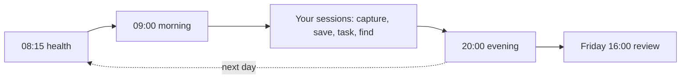

import { Aside } from '@astrojs/starlight/components';

Synapsidian works in two rhythms. While you work, skills file what matters when you ask. Around your work, scheduled runs keep the vault current without you.



## During the day

| You | What happens |
| --- | --- |
| type `>> …` | the text goes to `Inbox/` and is committed; no Claude turn |
| finish a piece of work | `/synapsidian:save` files decisions, how-tos, facts and tasks, and adds a devlog line |
| need to remember something | `/synapsidian:task add …` |
| ask what you know | `/synapsidian:find …` answers with links |
| share an article or a video | `/synapsidian:ingest …` keeps a copy and updates notes |
| end a session | the `SessionEnd` hook queues it for the evening |

## The runs

| Time | Run | Writes |
| --- | --- | --- |
| weekdays 08:15 | [`health`](/synapsidian/0.34/skills/health/) | safe fixes; what needs a decision, in today's note |
| weekdays 09:00 | [`morning`](/synapsidian/0.34/skills/morning/) | brief, agenda, today's meeting notes, what changed overnight |
| every day 20:00 | [`evening`](/synapsidian/0.34/skills/evening/) | the devlog from the day's sessions; their decisions and how-tos; Gemini meeting notes |
| Fridays 16:00 | [`review`](/synapsidian/0.34/skills/review/) | the week's review; the month's and quarter's on their last Friday |
| Mondays 08:30 | [`research watch`](/synapsidian/0.34/skills/research/) | refreshed research dossiers, when one is watched |

Health runs before the morning brief so the brief can list its commit. The review runs after the week's work. Each run is one commit, and the next morning's **Written overnight** lists it.

<Aside title="Missed runs catch up">
  The runs fire only while the desktop app is open. A run missed while the computer slept fires on the next launch. The evening run catches up every day still in its queue, and a review missed on Friday reviews that Friday when it runs on the weekend or on Monday.
</Aside>

## The daily note

The day's note collects it all:

```markdown
## Brief            ← morning (or daily)
## Agenda           ← morning, meeting
## Notes            ← yours
## Devlog           ← save, evening, and other skills
## Written overnight← morning
## Vault health     ← health, when there is something to report
```

See [Generated blocks](/synapsidian/0.34/concepts/generated-blocks/) for which parts are rewritten and which are yours.

## Set it up

[`/synapsidian:schedule`](/synapsidian/0.34/skills/schedule/) creates the scheduled tasks; then set each task's permission mode to **auto** and its folder to the vault. See [Scheduled runs](/synapsidian/0.34/configuration/scheduled-runs/).
